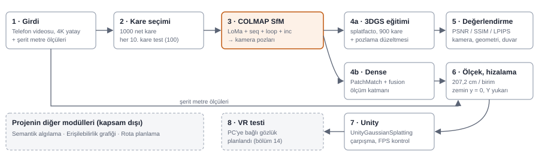

# 3DGS ve VR/Simülasyon Destekli Erişilebilir Rota Planlama Sistemi

**Bursa Uludağ Üniversitesi Bilgisayar Mühendisliği — Tasarım Projesi**
Sabri Duruk · Yunis Teymurlu · Danışman: Öğr. Gör. Koray AKİ

İç mekânların **3D Gaussian Splatting** ile dijital ikizlerini üreten ve
tekerlekli sandalye kullanan bireyler için erişilebilir rota planlayan
simülasyon sistemi.

---

## Hafta 5 Raporu — Rektörlük Derslik 4

**PDF:** [`docs/raporlar/hafta-05_raporu.pdf`](docs/raporlar/hafta-05_raporu.pdf)

### 1 Özet

**Rektörlük Derslik 4, telefonla çekilen 4K videodan metre ölçekli bir 3DGS modeline ve tam çözünürlükte bir dense nokta bulutuna çevrildi. Önerilen hat LoMa + sequential + loop + incremental 1000 karenin hepsini tek modelde yerleştirdi ve test karelerinde en yüksek kaliteyi verdi (25,23 dB).**

| **1000 / 1000** | **25,23 dB** | **207,2 cm** | **11,9 M** |
| :---: | :---: | :---: | :---: |
| LoMa incremental ile modele giren kare | 3DGS PSNR, 100 görülmemiş test karesinde (1080p) | model birimi başına gerçek uzunluk (3 ölçüyle) | dense nokta, 1920×1080, geometrik tutarlılıkla |

| Konu | Sonuç | Bölüm |
| :--- | :--- | :--- |
| Girdiden çıktıya sistem mimarisi | Video → kare seçimi → COLMAP SfM → 3DGS + dense → ölçek → Unity → VR | 2 |
| Test karelerinin SfM ve 3DGS'teki rolü | Her 10. kare (100 kare) SfM'e girer, 3DGS eğitimine girmez; kalite yalnız bu karelerde ölçülür | 3 |
| Yöntem karşılaştırması | LoMa incremental en doğru ve en kaliteli; hierarchical %31 hızlı ama 0,88 dB düşük; SIFT exhaustive 8 sa sürdü, 19 kare kaybetti | 4, 5 |
| Eğitime giremeyen kare | LoMa incremental 0 · LoMa hierarchical 1 · SIFT exhaustive 20 | 6 |
| Çözünürlük | 1440p, 1080p'ye göre +0,4 dB ama 2,7× süre ve 3× Gaussian; 4K'nın getirisi yok | 7 |
| Beyaz duvar lekeleri | Kaynağı otomatik pozlama; pozlama düzeltmesi (H2) temizledi | 8 |
| Hatalı kamera bölgeleri | 1000 kameradan 6'sı şüpheli, hepsi az gözlemli; model bozulmuyor | 9 |
| Dense rekonstrüksiyon | 11,9 M nokta, 72,8 M üçgenli yüzey; tam çözünürlükte 9 sa 45 dk (L4). Bina ölçeğinde 1400–1600 piksel önerilir | 10 |
| Eksik ve yanlış geometri | Dense'te zemin, oturaklar ve tavan neredeyse tam dolu (boş hücre ≤%0,8); duvar yüzeylerinin %36–60'ında nokta var, boşluklar pencere, kapı ve yansıyan yüzeylerde. Katlanma ya da çift duvar yok | 11 |
| Duvarlar arasında kayma | Kayma yok: dense'te duvarlar birbirine 0,3°'den az sapmayla paralel ve dik, düşeylik ≤0,5°, zemin eğilmesi ≤1,2 cm. Seyrek modeldeki 7° az noktadan kaynaklanıyordu | 12 |
| Gerçek ölçek ve doğrulama | Ölçekli; doğrulamada tüm ölçüler kısa (kanatlar ~%2, kapı toplamı ve platform %6–7), RMS 5,2 cm; kaynak kalibrasyon ölçüleri | 13 |
| Kapı genişliği güvenilirliği | Göreli olarak evet (tekrar farkı 1–2 cm), mutlak ±%6; "tek kanat 80 cm'den dar" kararı sağlam | 13 |
| Unity ve VR | Unity'ye aktarıldı; çekilmeyen açılarda splat dağınıklığı var, VR testi ertelendi | 14 |
| Çalıştırılabilir yapılandırma | `colmap_yapilandirma.sh`: bütün ayarlar tek dosyada, tek komut | 15 |

### 2 Sistem mimarisi

Girdi bir telefon videosu ve şerit metre ölçüleri; çıktı metre ölçeğinde, Unity'de gezilebilen bir 3DGS modeli ve ölçüm için dense nokta bulutu. Hattın merkezinde COLMAP SfM var: 3DGS eğitimi, dense ve ölçek kalibrasyonu onun bulduğu kamera pozlarını kullanıyor.



<sub>Şekil 1. Sistem mimarisi. Turuncu kutu önerilen SfM hattı; kesikli kutular henüz yapılmamış ya da bu raporun kapsamı dışındaki adımlar.</sub>

| Adım | Araç / betik | Çıktı |
| :--- | :--- | :--- |
| 1 · Girdi | Telefon (4K, 30 fps, yatay), şerit metre | Video, ölçü listesi, uç nokta fotoğrafları |
| 2 · Kare seçimi | `video_analiz.py`, `kare_secimi.py` | 1000 kare 1920×1080 (100'ü test) |
| 3 · COLMAP SfM | COLMAP 4.2.1 (CUDA + ONNX, yamalı), `colab_sfm.py` | Kamera pozları + seyrek nokta bulutu |
| 4a · 3DGS | nerfstudio 1.1.5 splatfacto, gsplat 1.4, `colab_gs.py` | Gaussian modeli (.ply) |
| 4b · Dense | pycolmap-cuda12 4.2.1, `colab_dense.py` | Dense nokta bulutu, Poisson yüzeyi |
| 5 · Değerlendirme | `colab_gs.py`, `analiz_kamera.py`, `analiz_eksik.py`, `analiz_duvar.py`, `analiz_dense.py` | Kalite ölçütleri, hata haritaları |
| 6 · Ölçek | `olcek_ucgenle.py`, `unity_ply.py` | Metre ölçekli, zemini y = 0 olan .ply |
| 7 · Unity | UnityGaussianSplatting (aras-p), `DerslikCarpisma.cs`, `FPSKontrol.cs` | Gezilebilir sahne |

<sub>Tablo 1. Adımların araçları ve çıktıları. Hesaplama Colab Pro'da L4 GPU (24 GB VRAM, 52 GB RAM) ile yapıldı; yalnız 4K model A100'de eğitildi.</sub>

### 3 Veri: çekim, kare seçimi, test kareleri

10 dk 19 sn'lik 4K yatay videodan (18.560 kare) 1000 net kare seçildi. Video 1000 eşit pencereye (0,6 sn) bölündü; her pencereden, hareketi kare başına 15 pikselin altında kalan en net kare (Laplace varyansı) alındı, hızlı dönüşler atıldı. Kareler SfM, dense ve karşılaştırma için 1920×1080, son model için 2560×1440 boyutunda çıkarıldı.

| Aşama | Test kareleri ne yapıyor? | Neden |
| :--- | :--- | :--- |
| SfM (COLMAP) | Diğer karelerle birlikte özellik çıkarma, eşleştirme ve harita kurmaya girer | 3DGS'in bu kareyi çizebilmesi için kameranın konumu bilinmeli; poz yalnız SfM'den gelir |
| 3DGS eğitimi | Eğitimden çıkarılır: 900 eğitim / 100 test | Model bu kareleri hiç görmez, ezberleyemez |
| Değerlendirme | Model her test karesinin pozundan bir görüntü çizer, gerçek fotoğrafla karşılaştırılır | Yeni bir bakış açısının ne kadar doğru üretildiğini ölçer |

<sub>Tablo 2. Test kareleri bütün yöntemlerde aynı 100 kare. Test kareleri de çekim yolu üzerinde olduğu için, ölçütler yoldan uzak bakış açılarındaki kaliteyi göstermez (bölüm 14).</sub>


<sub>Şekil 2. Test kareleri 0250, 0500, 0750: solda gerçek fotoğraf, sağda LoMa incremental modelinin aynı pozdan çizdiği görüntü. Kürsü, kapı ve sıralar doğru; beyaz duvarda gri lekeler var (bölüm 8).</sub>

### 4 Üç yöntemin SfM sonuçları

**LoMa + sequential + loop + incremental 1000 karenin hepsini 1 sa 42 dk'da tek modelde birleştirdi. Hierarchical aynı eşleştirmeyle SfM aşamasını 3,6 kat hızlı bitirdi ama izdüşüm hatası %55 yüksek. SIFT exhaustive 499.500 çifti karşılaştırmak için yaklaşık 7 saat harcadı ve yine de 19 kare kaybetti.**

| Aşama | LoMa + seq + loop + incremental | LoMa + seq + loop + hierarchical | SIFT exhaustive + incremental |
| :--- | :--- | :--- | :--- |
| Özellik çıkarma | 15,0 dk · VRAM 12,4 GB · RAM 2,3 GB (ortak) | 15,0 dk · VRAM 12,4 GB · RAM 2,3 GB (ortak) | 0,6 dk · VRAM 1,8 GB · RAM 0,3 GB |
| Kare başına anahtar nokta | 2.048 | 2.048 | 5.890 |
| Sözlük ağacı (döngü tespiti) | 26,6 dk · RAM 1,6 GB (ortak) | 26,6 dk · RAM 1,6 GB (ortak) | — |
| Eşleştirme | 15,8 dk · VRAM 0,7 GB · RAM 2,1 GB (ortak) | 15,8 dk · VRAM 0,7 GB · RAM 2,1 GB (ortak) | ~7 sa · VRAM 1,3 GB · RAM 0,5 GB |
| Eşleştirilen / doğrulanan çift | 12.945 / 11.344 | 12.945 / 11.344 | 499.500 / 105.521 |
| SfM (mapper) | 44,2 dk · RAM 2,2 GB | 12,4 dk · RAM 3,1 GB | 62,3 dk · RAM 2,2 GB |
| **Toplam süre** | **1 sa 42 dk** | **1 sa 10 dk** | **~8 sa** |

<sub>Tablo 3. Aşama aşama süre ve tepe bellek, L4 GPU. LoMa'nın ilk üç aşaması iki SfM yöntemi için bir kez koşuldu. SIFT eşleştirmesi Colab kesintisi nedeniyle iki oturumda tamamlandı.</sub>

| SfM sonucu | LoMa incremental | LoMa hierarchical | SIFT exhaustive |
| :--- | ---: | ---: | ---: |
| Modele giren kare | 1000 | 999 | 981 |
| Model sayısı | 1 | 1 | 1 |
| Seyrek 3B nokta | 246.479 | 242.427 | 217.043 |
| Ortalama iz uzunluğu (kare) | 5,75 | 5,48 | 4,75 |
| Ortalama yeniden izdüşüm hatası (px) | 1,32 | 2,04 | 0,95 |

<sub>Tablo 4. SfM modellerinin ölçütleri (1000 girdi karesi).</sub>

> **Düşük izdüşüm hatası tek başına iyi demek değil**  
> SIFT'in izdüşüm hatası en düşük (0,95 px), ama 19 kareyi yerleştiremedi ve noktaları daha az karede görülüyor (iz uzunluğu 4,75). Hata yalnız modele girebilen kolay karelerden hesaplanıyor. LoMa daha çok ve daha zor kareyi bağladığı için hatası biraz yüksek.

### 5 Üç yöntemin 3DGS sonuçları

**Aynı ayarlarla eğitilen üç modelden en kalitelisi LoMa incremental: 25,23 dB. SIFT 0,37 dB, hierarchical 0,88 dB geride. Üç eğitim de ~29 dakika sürdü ve 3 GB'ın altında VRAM kullandı.**

| Yöntem | Eğitim / test kare | PSNR (dB) | SSIM | LPIPS | Gaussian | Eğitim (dk) | VRAM (GB) | RAM (GB) |
| :--- | ---: | ---: | ---: | ---: | ---: | ---: | ---: | ---: |
| LoMa + seq + loop + incremental | 900 / 100 | 25,23 | 0,907 | 0,200 | 409 k | 29,5 | 3,0 | 19,4 |
| LoMa + seq + loop + hierarchical | 899 / 100 | 24,35 | 0,893 | 0,215 | 404 k | 29,0 | 2,9 | 19,3 |
| SIFT exhaustive + incremental | 881 / 99 | 24,86 | 0,902 | 0,207 | 404 k | 29,0 | 2,8 | 16,9 |

<sub>Tablo 5. 1080p, splatfacto varsayılanları, 30.000 iterasyon, L4 GPU. Yüksek PSNR ve SSIM, düşük LPIPS iyidir.</sub>


<sub>Şekil 3. Aynı test kareleri. Soldan: gerçek fotoğraf, LoMa incremental, LoMa hierarchical. Hierarchical'da ön sandalyede çift görüntü ve portrede bulanıklık var: alt modellerin birleştiği yerde poz kaymış.</sub>

> **Bina için önerilen hat**  
> LoMa + sequential + loop + incremental. Hem en çok kareyi yerleştiriyor hem en iyi görüntüyü veriyor; eşleştirme süresi kare sayısıyla doğrusal büyüdüğü için bina ölçeğine uygun. SIFT exhaustive'in eşleştirme süresi kare sayısının karesiyle büyüyor.

### 6 Eğitime giremeyen kareler

LoMa incremental hiç kare kaybetmedi. SIFT exhaustive'de 20 kare (%2) 3DGS eğitimine giremedi: 19'unu SfM yerleştiremedi, 1'i kopuk kamera olarak ayıklandı.

| Yöntem | SfM'e giren | Yerleştirilemeyen | Kopuk kamera | 3DGS'te kullanılan | Eğitim | Test |
| :--- | ---: | ---: | ---: | ---: | ---: | ---: |
| LoMa + seq + loop + incremental | 1000 | 0 | 0 | 1000 | 900 | 100 |
| LoMa + seq + loop + hierarchical | 1000 | 1 (0496) | 0 | 999 | 899 | 100 |
| SIFT exhaustive + incremental | 1000 | 19 | 1 | 980 | 881 | 99 |

<sub>Tablo 6. Kopuk kamera: en yakın 3 kameraya uzaklığı medyanın 10 katını aşan kamera; tek bir kopuk kamera bütün 3DGS modelini bozabildiği için eğitimden ayıklanır.</sub>

### 7 Çözünürlük: 1080p, 1440p (2K) ve 4K

**1440p, 1080p'ye göre 0,4 dB kazandırdı ve ince ayrıntıyı (portre, yazı) keskinleştirdi; buna karşılık eğitim 2,7 kat, RAM 2,4 kat ve Gaussian sayısı 3 kat arttı. 4K, 1440p'yi geçemedi.**

| Model | PSNR (dB) | SSIM | LPIPS | Gaussian | .ply (MB) | Eğitim (dk) | VRAM (GB) | RAM (GB) | GPU |
| :--- | ---: | ---: | ---: | ---: | ---: | ---: | ---: | ---: | :--- |
| 1080p splatfacto | 25,23 | 0,907 | 0,200 | 409 k | ~100 | 29,5 | 3,0 | 19,4 | L4 |
| 1440p splatfacto-big | 25,63 | 0,912 | 0,210 | 1,25 M | 262 | 79,5 | 5,5 | 45,8 | L4 |
| 4K splatfacto-big | 25,38 | 0,930 | 0,242 | 1,30 M | 272 | 41,6 | 53,3 | 49,6 | A100 |

<sub>Tablo 7. LoMa incremental pozları, aynı 100 test karesi; her model kendi çözünürlüğünde ölçüldü. 1080p modeli splatfacto, diğerleri splatfacto-big ile eğitildi; farkın bir kısmı bu ayardan gelir. 4K'nın ilk denemesi L4'te bellek taşmasıyla durdu (nerfstudio kareleri RAM'de ikinci kez kopyalıyordu); kopya kapatıldıktan sonra tepe RAM 49,6 GB oldu, L4'ün 52 GB'ına çok yakın olduğu için eğitim A100'de yapıldı.</sub>


<sub>Şekil 4. Duvar ve portre yakın kırpımı. Soldan: gerçek kare, 1080p splatfacto, 1440p splatfacto-big. Daha yüksek çözünürlük portreyi keskinleştiriyor, duvardaki lekeleri gidermiyor.</sub>

> **Hangi çözünürlük?**  
> 4K mantıklı değil: Gaussian sayısı 1,25 M'dan 1,30 M'a çıktı, aynı bütçe 4K'nın ince ayrıntısını taşıyamıyor; LPIPS kötüleşti ve A100 gerekti. SfM, dense ve denemeler 1080p'de yapılmalı (hızlı, ucuz). Gösterilecek son model için 1440p + pozlama düzeltmesi öneriliyor; bina ölçeğinde VR'ın Gaussian bütçesi zorlarsa 1080p yeterli, kalite farkı küçük (0,4 dB).

### 8 Beyaz duvar iyileştirmesi

**Taban modelde beyaz duvarlarda gri lekeler var. Kaynağı telefonun otomatik pozlaması: aynı duvar bir karede açık, başka karede grimsi kaydedildiği için model aradaki farkı duvarın önüne yarı saydam gri Gaussian'lar koyarak açıklıyor. Yalnız pozlama düzeltmesi (H2) bu lekeleri büyük ölçüde temizledi; kamera pozu ince ayarı (H) ve monoküler derinlik (DN) modeli bozdu.**

| Koşu | PSNR ham (dB) | PSNR renk düzeltmeli (dB) | LPIPS düzeltmeli | Gaussian | Eğitim (dk) | Görsel |
| :--- | ---: | ---: | ---: | ---: | ---: | :--- |
| Taban (splatfacto) | 25,23 | 25,68 | 0,198 | 409 k | 29,5 | duvarda gri lekeler |
| H: pozlama düzeltme + kamera pozu ince ayarı | 20,24 | 21,48 | 0,226 | 373 k | 79,2 | temiz ama kaymış |
| H2: yalnız pozlama düzeltme (bilateral grid) | 23,16 | 25,33 | 0,191 | 411 k | 78,3 | temiz, hizalı · önerilen |
| DN: DN-Splatter, monoküler derinlik | 23,19 | 23,60 | 0,246 | 460 k | 228 | lekeli, portre bozuk |
| H2, 1440p splatfacto-big | 21,43 | 25,29 | 0,210 | 1,16 M | 130,7 | 1080p H2 ile aynı yönde |

<sub>Tablo 8. Renk düzeltmeli ölçüt: her test karesinde çizilen görüntü ile gerçek kare arasındaki renk farkı giderildikten sonra hesaplanır; pozlama farkını ayırır, geometri ve keskinlik farkını ayırmaz. Hepsi 1080p (son satır 1440p), 30.000 iterasyon, L4 GPU.</sub>

| Koşu | Eğitim (dk) | Ek süre (dk) | Colab birimi | Ek gereksinim |
| :--- | ---: | ---: | ---: | :--- |
| Taban (splatfacto) | 29,5 | — | 0,8 | — |
| H2: pozlama düzeltme | 78,3 | +48,8 | 2,0 | Tek ayar; ek kurulum ve veri yok |
| H: pozlama + kamera pozu ince ayarı | 79,2 | +49,7 | 2,0 | Tek ayar; sonucu kullanılamaz |
| DN: DN-Splatter | 228 | +198,5 | 5,9 | Ayrı ortam (eski nerfstudio/gsplat), her kare için derinlik tahmini, ~25 GB RAM |
| H2, 1440p splatfacto-big | 130,7 | +51,2 (1440p tabana göre) | 3,4 | 1440p kareler; ~46 GB RAM |

<sub>Tablo 9. İyileştirme koşularının maliyeti. Colab birimi L4'ün saatlik ~1,54 birimiyle hesaplandı; kurulum süresi dahil değil. 1440p'nin ek süresi 1440p taban (79,5 dk) ile karşılaştırılmıştır.</sub>


<sub>Şekil 5. Soldan: gerçek kare, taban model, pozlama düzeltmeli model (H2). Perde ve duvardaki gri bulutlar düzeltmeyle kayboluyor.</sub>

- **H2 nasıl çalışıyor?** Her eğitim karesine ayrı, küçük bir renk-parlaklık dönüşümü (bilateral grid) öğretiliyor; model çizdiği görüntüyü bu dönüşümden geçirip gerçek kareyle karşılaştırıyor. Kareden kareye pozlama farkı sahneye değil dönüşüme yükleniyor, duvar her yerde aynı renkte kalıyor. Dönüşüm .ply'ye girmiyor; Unity'de nötr renk görünüyor.
- **H2'nin ham PSNR'ı neden düşük?** Test karesinin kendi pozlaması bilinmediği için model nötr renk veriyor. Renk farkı giderilince PSNR tabanla aynı düzeyde (−0,35 dB), LPIPS daha iyi.
- **H2'nin maliyeti.** Eğitim 29,5 dakikadan 78,3 dakikaya çıkıyor (2,7×, oda başına ~49 dk ve ~1,2 Colab birimi fazla). Ek kurulum, veri ya da bellek gerekmiyor; Gaussian sayısı ve Unity'deki gösterim yükü değişmiyor. Geometri eksikliğini (az noktalı duvarlar) gidermiyor.
- **H neden kötü?** Kamera pozu ince ayarı eğitim pozlarını kaydırıyor; görüntü test karesine göre kaymış çıkıyor. Kullanılmamalı.
- **DN neden kötü?** Monoküler derinlik (Depth Anything V2) COLMAP noktalarına göre kare başına %9–12 tutarsız ve ölçeği kareden kareye değişiyor; model renk ile derinlik arasında kalıyor. İki test karesinde (0210: 13,2 dB, 0680: 15,1 dB) görüntü tamamen bozuldu. Normal kaybı kurulum sorunu yüzünden kullanılamadı; eğitim 3,8 saat sürdü.

### 9 Kamera konumunun hatalı olabileceği bölgeler

**LoMa incremental modelinde 1000 kameradan yalnız 6'sı şüpheli ve hepsi aynı sebepten: az sayıda 3B noktaya bağlılar. İzdüşüm hatası yüksek ya da yolunda sıçrama yapan kamera yok.**


<sub>Şekil 6. Kat planında her kamera dört ölçüte göre renklendirildi; kırmızı halka şüpheli kamera. Beşi sıra aralarındaki yürüyüşün sol uçlarında (dönüş noktaları), biri alt uzun duvar boyunca sağda.</sub>

| Ölçüt | Şüpheli sayılma koşulu | LoMa incremental | LoMa hierarchical |
| :--- | :--- | :--- | :--- |
| Yeniden izdüşüm hatası | yüksek hata | 0 (medyan 1,49 px, en yüksek 2,00 px) | 1 (medyan 2,17 px, en yüksek 5,08 px) |
| Gözlem sayısı | az 3B noktaya bağlı | 6 (medyan 1461, en düşük 138) | 9 (medyan 1383, en düşük 142) |
| Yörünge sıçraması | adım, medyanın çok üstünde | 0 (en yüksek 2,6 kat) | 0 (en yüksek 2,8 kat) |
| İki yöntem arası konum farkı | incremental ile hierarchical ayrışıyor | 1 (medyan 1,4 cm, en yüksek 19 cm) | 1 (medyan 1,4 cm, en yüksek 19 cm) |
| **Toplam şüpheli** |  | **6 / 1000** | **9 / 999** |

<sub>Tablo 10. Kamera güvenilirlik ölçütleri. Uzaklıklar 207,2 cm / birim ölçeğiyle; şüpheli kareler 0413, 0414, 0496, 0923, 0924, 0974.</sub>

Bu noktalarda kamera duvara ya da köşeye yakından bakıyor, görüntüde eşleştirilecek doku az. Konumları çevreleriyle uyumlu, modeli bozmuyorlar. Videonun sonu başının üstüne oturuyor: döngü kapandı, yol kaymadı. Bina çekiminde dönüşleri duvardan uzakta yapmak bu kareleri azaltır.

### 10 Dense rekonstrüksiyon

**Önerilen modelin 1000 kamerasıyla tam çözünürlükte dense rekonstrüksiyon hatasız tamamlandı: 11,9 milyon noktalı bir bulut ve 72,8 milyon üçgenli bir Poisson yüzeyi. Toplam süre L4'te 9 sa 45 dk; bunun %94'ü PatchMatch.**

| Aşama | Süre | Tepe RAM (GB) | Tepe VRAM (GB) | Çıktı |
| :--- | ---: | ---: | ---: | :--- |
| Bozulma giderme (undistort) | 0,5 dk | 0,4 | — | 1000 düzeltilmiş kare |
| PatchMatch, fotometrik geçiş | ~3,5 sa | 34,5 | 1,3 | 1000 derinlik + normal haritası |
| PatchMatch, geometrik geçiş | ~5,7 sa |  |  | 1000 tutarlılığı denetlenmiş harita |
| Fusion | 13,2 dk | 43,5 | — | 11,9 M nokta |
| Poisson yüzeyi | 19,2 dk | 29,1 | — | 72,8 M üçgen |
| **Toplam** | **9 sa 45 dk** |  |  |  |

<sub>Tablo 11. Dense, LoMa incremental pozlarıyla, 1920×1080 tam çözünürlükte, COLMAP 4.2.1 varsayılanları (her kare için 20 komşu kare, geometrik tutarlılık açık). Colab Ubuntu 24.04 / CUDA 13'e geçtiği için pip'teki pycolmap-cuda12 kullanıldı; bu pakette Delaunay yüzeyi yok.</sub>


<sub>Şekil 7. Solda dense kat planı (üstten, 2,5 m altındaki noktalar; renkli çizgiler duvar düzlemleri), sağda her duvar boyunca düzlemden sapma. Duvar doğruları, her 25 cm'lik dilimdeki en dış yoğun yüzeyden (duvar yüzü) RANSAC ile oturtuldu; eksenler duvarlara hizalandı (4,65°). Salonun iç ölçüsü 20,62 × 14,35 m.</sub>

> **Süre neden uzun ve bina ölçeğinde ne yapılmalı?**  
> 4. haftada 349 kare 1000 piksele küçültülerek 93 dakikada işlenmişti. Burada kare sayısı ~3 kat, kare başına piksel 3,7 kat; iş ~11 kat büyüdü. Geometrik geçiş her karenin komşu haritalarını da okuduğu için fotometrik geçişten ~1,6 kat yavaş. Tam çözünürlükte dense 1000 kare başına L4'te ~9,7 saat sürüyor; bütün binada bu pratik değil. Ölçüm katmanı için 1400–1600 piksel (süre yaklaşık yarıya iner) ya da daha hızlı GPU önerilir.

### 11 Eksik ve yanlış geometri

**Dense bulut, seyrek bulutta zayıf kalan duvar katmanını büyük ölçüde doldurdu. Zemin, oturaklar ve tavan neredeyse tam dolu; duvar yüzeylerinin %36–60'ında 10 cm'lik çözünürlükte nokta var. Kalan boşluklar pencere camında, kapıda ve ön duvardaki projeksiyon perdesi gibi parlak, dokusuz yüzeylerde. Modelde katlanma ya da çift duvar yok.**

| Katman | Bulut | Salon içi boş hücre (%) | Az görülen hücre, <5 kamera (%) | Medyan kamera |
| :--- | :--- | ---: | ---: | ---: |
| Zemin ve oturaklar | seyrek | 0,0 | 0,5 | 60 |
|  | dense | 0,8 | 26,7 | 5,4 |
| Duvar, kapı, pencere | seyrek | 3,2 | 11,3 | 18 |
|  | dense | 4,3 | 17,9 | 6,0 |
| Tavan | seyrek | 0,1 | 0,3 | 90 |
|  | dense | 0,2 | 4,7 | 6,4 |

<sub>Tablo 12. Kat planı hücreleri (kenar ~50 cm, salon uzunluğunun %2,5'i). Seyrek bulutta "kamera" hücredeki noktaları gören farklı kamera sayısı; dense'te noktanın birleştirildiği derinlik haritası sayısının hücre ortalaması (iki ölçüt doğrudan karşılaştırılamaz, eğilim için verilmiştir). Salon içi hücreler duvarı değil iç alanı ölçer; orta katmanda boş hücre çoğunlukla eşyasız boş alandır. Duvarların kapsamı için Tablo 13'teki yüzey kapsamına bakılmalıdır.</sub>


<sub>Şekil 8. Dense kat planında geometri kapsamı: üstte nokta yoğunluğu, altta noktaları gören ortalama kamera sayısı; siyah ve beyaz hücreler boş. Orta katmanda platform önündeki boş alan (x ≈ 6–10 m) eşya olmadığı için boş görünüyor; bu eksik geometri değil, boş mekândır.</sub>


<sub>Şekil 9. Seyrek bulutta sıra ve tavan ızgarası çizgileri düz ve paralel: sıra çizgilerinin medyan sapması salonun %1,1'i, en büyük açı farkı 0,8°. Bir sıra aralığının iki ucu arasındaki %10,6'lık fark tek bozuk bölge. Modelde katlanma ya da çift duvar yok.</sub>

### 12 Duvarlar arasında geometrik kayma

**Duvarlar arasında geometrik kayma yok. Dense bulutta karşılıklı duvarlar birbirine 0,02° ve 0,28° içinde paralel, komşu duvarlar 0,28° içinde dik; duvarların düşeyliği 0,5°'den iyi, zemin 20 m boyunca 0,6 cm eğiliyor. Seyrek bulutta alt uzun duvarda görülen 7°'lik sapma, o duvarın yalnız %25'inde nokta bulunmasından kaynaklanıyordu.**

| Duvar | Uzunluk (m) | Boyunca kapsam (%) | Yüzey kapsamı (%) | RMS (cm) | Kayma (cm) | Düşeylik (°) |
| :--- | ---: | ---: | ---: | ---: | ---: | ---: |
| Üst uzun (pencereli) | 19,7 | 38 | 57 | 1,6 | 4,0 | 0,5 |
| Alt uzun | 19,7 | 53 | 44 | 1,4 | 2,4 | 0,4 |
| Sol kısa | 13,0 | 81 | 60 | 1,3 | 3,8 | 0,2 |
| Sağ kısa (ön, perde) | 13,0 | 45 | 36 | 1,9 | 4,4 | 0,3 |

<sub>Tablo 13. Duvar düzlemleri, dense bulut (1 cm voksel, 1–3 m yükseklik bandı). Uzunluk: incelenen bölüm (kamera yolunun boyu). RMS: dilim yüzlerinin düzlemden ortalama sapması. Düşeylik: düzlemin düşeyden sapması. Boyunca kapsam: duvar yüzü düzleme 3 cm içinde oturan 25 cm'lik dilimlerin oranı (pencere girintileri ve kapılar dışarıda kalır). Yüzey kapsamı: 10 cm'lik hücrelerden nokta içerenlerin oranı. Kayma: dilim yüzlerinin düzlemden sapmasının duvar boyunca en büyük farkı; pencere pervazı ve kolonlar dahil.</sub>

| İlişki | Seyrek bulut (°) | Dense bulut (°) |
| :--- | ---: | ---: |
| Üst uzun – sol / sağ kısa (diklikten sapma) | 1,0 / 0,2 | 0,00 / 0,28 |
| Alt uzun – sol / sağ kısa (diklikten sapma) | 7,6 / 6,9 | 0,02 / 0,26 |
| Kısa duvarlar, paralellikten sapma | 2,2 | 0,28 |
| Uzun duvarlar, paralellikten sapma | 7,2 | 0,02 |
| Zemin eğilmesi, uzun / kısa eksen (cm) | 1,3 / 0,7 | 0,6 / 1,2 |

<sub>Tablo 14. Duvarlar ve zemin arasındaki açılar. Seyrek sütun önceki analizden; zemin yüzdeleri salon uzunluğuyla (kamera yolu, 20,2 m) cm'ye çevrildi. Dense'te eksenler önce duvarlara hizalandı; açılar eksen seçiminden bağımsızdır.</sub>

### 13 Ölçek kalibrasyonu, doğrulama ve hata analizi

**Model 3 şerit metre ölçüsüyle gerçek ölçeğe getirildi: 207,2 cm / model birimi. Dört doğrulama ölçüsünün hepsi modelde gerçeğinden kısa çıktı: kapı kanatları ~%2 (ölçü belirsizliği içinde), kapının toplam genişliği ve platform %6–7. Hata yönü sistematik; kaynağı modelin geometrisi değil, kalibrasyon ölçüleri.**

Her ölçünün uç noktaları 2–3 karede elle işaretlendi, komşu karelerde eşlendi ve bilinen SfM pozlarıyla üçgenlendi (yeniden izdüşüm hatası 0–3 px).

| Kod | Nesne | Ölçülen (cm) | Model (birim) | Tek başına ölçek (cm/birim) | Ölçekli model (cm) | Sapma (cm) |
| :--- | :--- | ---: | ---: | ---: | ---: | ---: |
| M1 | Öğretmen masası, ön üst kenar | 120 | 0,603 | 199 | 124,9 | +4,9 |
| K1 | Kürsü üst tablası | 70 | 0,396 | 177 | 82,1 | +12,1 |
| D1 | Kapı, iki kanat, kasanın dış kenarları arası | 155 | 0,694 | 223 | 143,8 | −11,2 |
| **En küçük kareler ölçeği** | **En küçük kareler ölçeği** | **En küçük kareler ölçeği** | **En küçük kareler ölçeği** | **207,2** |  |  |

<sub>Tablo 15. Kalibrasyon ölçüleri (şerit metre, ±1,5–2 cm). Tek tek ölçeklerin yayılımı ±%12.</sub>

| Kod | Nesne | Ölçülen (cm) | Model (cm) | Sapma (cm) | Sapma (%) |
| :--- | :--- | ---: | ---: | ---: | ---: |
| D2a | Kapı sol kanat | 70–75 | 71,1 | −1,4 | −1,9 |
| D2b | Kapı sağ kanat | 70–75 | 71,4 | −1,1 | −1,5 |
| D3 | Kapı toplam genişlik, ayrı işaretleme (iç köşeler) | 155 | 145,2 | −9,8 | −6,3 |
| B1 | Öğretmen platformu yüksekliği | 43,5 | 40,6 | −2,9 | −6,7 |
| **RMS** | **RMS** | **RMS** | **RMS** | **5,2** |  |

<sub>Tablo 16. Doğrulama ölçüleri, 207,2 cm/birim ile. Kanat genişliği yalnız 70–75 cm aralığıyla biliniyor; sapma aralığın ortasına (72,5 cm) göre verildi ve ±2,5 cm belirsizlik taşıyor. D3, kalibrasyondaki D1 ile aynı kapıdır (ayrı işaretleme). Sıra tablası eni (30 cm), iki ucu hiçbir karede birlikte görünmediği için ölçülemedi.</sub>


<sub>Şekil 10. Kapı, dense buluttan tam önden (ortografik, perspektifsiz) görünüş; halkalar üçgenlenen kasa köşeleri. Ölçü kapı düzleminde, 3B noktalar arasında alınır. Koyu ve dokusuz kanat yüzeylerinde dense nokta seyrek; kasa, orta kayıt ve kol net.</sub>

#### Hata analizi

- **Yön sistematik.** Dört doğrulamanın dördü de aynı yönde (kısa). Rastgele işaretleme hatası olsaydı işaretler karışık çıkardı. Büyüklük ise ikiye ayrılıyor: kanatlar ölçü belirsizliği içinde, kapı toplamı ve platform %6–7 kısa.
- **Tekrarlanabilirlik iyi.** Kapının toplam genişliği iki ayrı işaretlemeyle 143,8 ve 145,2 cm çıktı (fark 1,4 cm). Kanat genişlikleri 3 farklı karede 0,2 cm içinde tutarlı.
- **Kaynak: kalibrasyon ölçüleri.** Masa ve kürsü modelde ölçülenden uzun (%4, %17), kapı kısa (%7). Masa ve kürsü yuvarlak kenarlı ve uç noktaları belirsiz; en küçük kareler bu üçünün arasını bulduğu için ölçek biraz küçük kalmış. Yalnız kapıyla ölçeklense (222,9 cm/birim) platform 43,7 cm çıkar (ölçülen 43,5), ama masa 134 cm, kürsü 88 cm olur.
- **SfM kayması yok.** Masa, kürsü ve kapı birbirine yakın; zemin ve tavan düz (bölüm 12). Sapma modelin geometrisinden değil, ölçek için kullanılan ölçülerden geliyor.

| Büyüklük (207,2 cm/birim ile) | Model | Beklenen | Durum |
| :--- | ---: | ---: | :--- |
| Masa üst yüzeyi, platformdan | 0,74 m | ~0,75 m | standart masa |
| Kürsü üst tablası, platformdan | 1,09–1,14 m | ~1,1 m | standart kürsü |
| Kapı kasası üst köşesi, zeminden | 2,05–2,09 m | ~2,1 m | standart kapı |
| Kamera yüksekliği (medyan) | 1,28 m | elde çekim | gerçekçi |
| Oda boyu × eni (dense, duvar düzlemleri arası) | 20,62 × 14,35 m | ölçülmedi | gerçek ölçü yok |
| Oda yüksekliği, zemin–tavan (dense) | 4,13 m (ızgara) · 3,32 m (asma lamba) | ölçülmedi | gerçek ölçü yok |

<sub>Tablo 17. Bağımsız denetim: standart yüksekliklerle karşılaştırma ve dense'ten çıkarılan oda boyutları. Pencere ve oda eni/boyu gibi büyük ölçüler çekimde şerit metreyle alınamadı; oda boyutları bu yüzden doğrulanamıyor.</sub>

> **Kapı genişliği güvenilir ölçülebiliyor mu?**  
> Göreli olarak evet: model aynı kapıyı tekrar tekrar 1–2 cm içinde ölçüyor. Mutlak olarak yaklaşık ±%6 hatayla. Rota kararı için yeterli: tek kanat 71–77 cm (ölçek seçimine göre), tekerlekli sandalye için genellikle 80 cm ve üzeri net genişlik istendiği için "tek kanat yetersiz" sonucu bu hatadan etkilenmiyor. 80 cm'ye yakın kapılarda daha iyi bir ölçek gerekir.

### 14 Unity ve VR

**Model metre ölçeğinde, Y ekseni yukarı ve zemini y = 0 olacak şekilde Unity'ye aktarıldı; çarpışma kutuları ve birinci şahıs kontrol betikleri hazır. Unity'de gezerken görüntü keskin ve hatasız değildi; bu yüzden VR gözlük testi ertelendi.**

- **Gözlem.** Çekim yolundan bakınca model düzgün. Yoldan ayrılan açılarda, örneğin sıra aralarında ilerlerken sağa ya da sola dönüp sıralara bakınca, Gaussian'lar dağınık görünüyor: ince uzun "iğne" Gaussian'lar ve yarı saydam bulutlar.
- **Neden.** 3DGS yalnız eğitimde gördüğü açıları doğru göstermeyi öğreniyor; çekimde sıralara yandan hiç bakılmadı. Test kareleri de aynı yürüyüş yolundan seçildiği için PSNR bu sorunu göstermiyor.
- **VR.** VR'da baş hareketi bu açıları sürekli gösterdiği için rahatsızlık daha belirgin olacaktır; test, görüntü düzeltildikten sonra PC'ye bağlı gözlükle yapılacak. Bu bir VR ölçümü değil, Unity gözlemine dayalı bir karardır.

| Çözüm yolu | Ne yapar | Beklenen etki | Durum |
| :--- | :--- | :--- | :--- |
| Çekimde yan bakışlar | Sıra aralarında sağa-sola bakış, üç yükseklik, ortadan geçiş | En etkili; model görmediği açıyı uyduramaz | Sonraki çekim |
| Eğitim ayarları | Ölçek düzenlemesi, MCMC ve Gaussian sınırı | İğne Gaussian'ları ve bulutları azaltır | Colab'da ~1 sa deneme |
| Geometri öncülleri | Derinlik / normal / düzlem bilgisi | Literatürde duvar hatası 2–3 kat düşüyor | Monoküler derinlikle denendi, kötüleşti (bölüm 8); LiDAR derinliğiyle umut verici |
| Üretken düzeltici (Difix3D+, NVIDIA) | Görülmemiş açılardan çizilen görüntüleri düzeltip modeli yeniden eğitir | Görsel olarak en güçlü; görüntü uydurabilir | Ücretsiz, ticari olmayan lisans; ~3–5 sa deneme. Yalnız görsel katman için, ölçüm için değil |

<sub>Tablo 18. Çekilmeyen açılardaki dağınıklık için çözüm yolları.</sub>

**Nesneleri tek tek konumlandırma.** 3DGS modelinde nesneler ayrı değil; önce ayrılmaları gerekiyor. Kısa vadede bir nesne SuperSplat ya da Unity eklentisinin kesme aracıyla ayrı .ply olarak kesilip Unity'de ayrı obje olarak taşınabilir. Otomatik yol SAM maskelerini 3B'ye taşıyan bölütleme yöntemleri (Gaussian Grouping, SAGA). Rota planlama için asıl gereken nesneyi taşımak değil, yerini ve kapladığı alanı bilmek: bu, dense nokta bulutundan nesne kutuları çıkarılıp Unity'de çarpışma kutusu olarak yerleştirilerek yapılabilir. Taşınan nesnenin arkasında ve altında, kamera orayı görmediği için boşluk kalır.

### 15 Çalıştırılabilir COLMAP yapılandırması

Derslik 4'te kullanılan bütün COLMAP ayarları tek bir dosyada toplandı: `scripts/hafta05/colmap_yapilandirma.sh`. Aynı sonuç aynı ayarlarla tek komutla yeniden üretilebilir; yeni odalar da aynı dosyayla işlenir.

```bash
# önerilen hat: LoMa + sequential + loop + incremental
bash colmap_yapilandirma.sh frames_1080 sfm loma
# üç yöntem birden (incremental, hierarchical, SIFT exhaustive)
bash colmap_yapilandirma.sh frames_1080 sfm hepsi
# önerilen hat + tam çözünürlükte dense
bash colmap_yapilandirma.sh frames_1080 sfm loma dense
```

| Ayar | Değer | Ne işe yarar |
| :--- | :--- | :--- |
| Kamera modeli | OPENCV, tek kamera | Bütün kareler aynı telefondan; mercek bozulması da çözülür |
| Özellik çıkarma ve eşleştirme | LOMA_B | Öğrenme tabanlı LoMa; beyaz duvarda SIFT'ten güçlü |
| Sözlük ağacı | 8.192 görsel kelime, 400.000 tanımlayıcı | Döngü tespiti için; bu çekimin LoMa tanımlayıcılarından kurulur |
| Sequential eşleştirme + döngü | her 10 karede bir, 50 aday kare | Videonun sonunda başa dönülen bölüm ilk karelere bağlanır |
| SfM | incremental (mapper) | En doğru; 1000/1000 kare |
| Hierarchical (isteğe bağlı) | alt model başına en çok 250 kare | Daha hızlı; birleşme yerinde kayma riski |
| SIFT (isteğe bağlı) | exhaustive, SIFT_BRUTEFORCE | Karşılaştırma için; 1000 karede ~7 sa eşleştirme |
| Dense (isteğe bağlı) | tam çözünürlük, geometrik tutarlılık | Ölçüm katmanı; 1000 karede L4'te ~9,7 sa |
| Rastgelelik tohumu | 1 | Aynı girdiyle aynı sonuç |

<sub>Tablo 19. Yapılandırmadaki ayarlar.</sub>

> **Önkoşul**  
> COLMAP 4.2.1, CUDA ve ONNX ile derlenmiş olmalı ve sözlük ağacı komutu LoMa'nın 256 boyutlu tanımlayıcısı için yamalı olmalı (`src/colmap/exe/vocab_tree.cc`, tek satır). Drive'daki hazır derleme (`kurulum/colmap_4.2.1_l4.tgz`) eski Colab görüntüsü (Ubuntu 22.04, CUDA 12) ve L4 içindir. Colab Ubuntu 24.04 / CUDA 13'e geçtiği için SfM adımları bu ortamda kaynaktan yeniden derleme gerektirir; dense için pip'teki `pycolmap-cuda12==4.2.1` yeterlidir. pip'teki pycolmap LoMa'yı çalıştırmaz (ONNX yok).

### 16 Bina ölçeği için öneriler

| Karar | Öneri | Dayanak |
| :--- | :--- | :--- |
| SfM yöntemi | LoMa + sequential + loop + incremental, kat başına bir SfM | Hafta 4 ve 5'te en doğru; süre kare sayısıyla doğrusal; oda ile koridor aynı koordinatta |
| 3DGS | Oda / koridor parçaları hâlinde, 1440p + pozlama düzeltmesi; VR bütçesi zorlarsa 1080p | Bölüm 7, 8; tek parça kat ~6 M Gaussian eder |
| Ölçüm katmanı | Dense, 1400–1600 piksel | Tam çözünürlük 1000 karede ~9,7 sa (bölüm 10) |
| Kaçınılacak | SIFT exhaustive (karesel süre), hierarchical (birleşimde kayma), kamera pozu ince ayarı, monoküler derinlik | Bölüm 4, 5, 8 |

<sub>Tablo 20. Yöntem kararları.</sub>

| Konu | Uygulama |
| :--- | :--- |
| Kamera ayarları | Manuel kontrollü uygulama; pozlama, ISO, beyaz dengesi ve odak kilitli; enstantane en az 1/250 s; 4K 60 fps; HDR ve görüntü sabitleme kapalı; bütün çekimde tek lens |
| Genel rota | Başlangıç noktasına dönerek döngüyü kapat; dönüşleri duvardan uzakta yap; yerinde dönme; beyaz duvara yakından bakma, kadrajda köşe, kapı ya da pano olsun |
| Derslik | Köşeden başla; duvar boyunca içe bakan iki tur ve bir orta geçiş; ~0,8 / 1,5 / 2 m üç yükseklik; sıra aralarında sağa ve sola bakış |
| Koridor | İki yönde yürü, kamera duvara 30–45° dönük; her kapıyı hem koridordan hem odadan çek (parçalar orada birleşir); kapı numarası ve panolar kadrajda |
| Merdiven | Yavaş; üst ve alt sahanlıktan boyuna, basamaklara yandan; iki katı bağlayan tek kesintisiz çekim |
| Dış cephe | Ayrı SfM; binaya bakan yay, iki mesafe; bulutlu gün (cam yansıması); girişler içten ve dıştan çekilir, iç ve dış model orada hizalanır |
| Ölçek ve doğrulama | Keskin köşeli büyük nesneler (kapı, pencere, koridor boyu); kat başına en az 3 kalibrasyon ve 5 farklı nesneden doğrulama; uç noktalar fotoğraflanır; oda eni/boyu ve pencereler de ölçülür; mümkünse bilinen boyutta basılı hedefler. LiDAR'lı bir iPhone ile paralel kayıt ölçeği ve duvar geometrisini birlikte iyileştirir |

<sub>Tablo 21. Bina çekim protokolü.</sub>

### 17 Sınırlamalar ve sonraki adımlar

- Doğrulama 4 ölçüyle yapıldı; bunların 3'ü aynı kapıya ait, bağımsız nesne sayısı 2. Kanat genişliği yalnız 70–75 cm aralığıyla biliniyor. Pencere ve oda eni/boyu ölçülmediği için dense'ten çıkan oda boyutları doğrulanamıyor.
- Test kareleri çekim yolu üzerinde; PSNR yoldan uzak açılardaki kaliteyi göstermiyor.
- VR gözlük testi yapılmadı.
- Sonraki adımlar: (1) bir katın pilot çekimi (iki koridor, iki derslik, merdiven) yeni protokolle ve büyük ölçülerle; (2) ölçek düzenlemesi + MCMC eğitimi, ardından Difix3D+ denemesi; (3) PC'ye bağlı gözlükle VR testi; (4) dense'ten kapı ve koridor genişliklerinin otomatik çıkarılması.

### 18 Kod ve veri

| Yer | İçerik |
| :--- | :--- |
| GitHub | `yunisyns2506/accessible-route-planning`, dal `test/3dgs-pilot-runs`: betikler `scripts/hafta05/`, analizler ve ölçüm `experiments/hafta-05_derslik-04/` (dense analizi `analiz/adim4_dense_inc/`) |
| Drive `hafta5_derslik4/` | `sfm/` COLMAP modelleri · `runs/` eğitim çıktıları ve .ply · `dense/loma_inc/` dense bulut, Poisson yüzeyi, süre ve bellek kayıtları · `unity/` Unity'ye hazır .ply · `betikler/` |
| Unity modelleri | Hepsi metre, Y yukarı, zemin y = 0: `derslik4_1440_big_H2_unity.ply`, `derslik4_H2_unity.ply`, `derslik4_1440big_unity.ply` |

---

## Önceki haftalar

<details>
<summary>Hafta 4 — COLMAP yöntem karşılaştırması (özet)</summary>

**A1 (mekân modelleme) devam ediyor.** COLMAP'in tüm yöntem ailesi aynı veri
(D207, 349 kare) ve aynı donanımda karşılaştırıldı: **3 özellik çıkarıcı × 5
eşleştirme × 3 SfM yöntemi = 39 SfM koşusu, 16 3DGS eğitimi (30k), 3 dense
rekonstrüksiyon.** LoMa'nın sözlük ağacı gerektiren 3 stratejisi koşulamadı
(gerekçe raporda). Sonuçlar çok katlı bina için yöntem seçimine bağlandı.

**→ [Hafta 4 Raporu](docs/raporlar/hafta-04_raporu.md)** · [Hafta 3 Raporu](docs/raporlar/hafta-03_raporu.md)

### Öne çıkanlar

| Bulgu | Sonuç |
| :--- | :--- |
| Kalite ölçütü | Kayıt oranı yanıltıcı; **doğru pozlanan kare oranı** 3DGS kalitesini belirliyor |
| SIFT | exhaustive + incremental en iyi (PSNR 28,26) ama 5.000 karede eşleştirme ~128 sa |
| ALIKED + LightGlue | Tekrar eden mekânda yanlış eşleşme → oda katlanıyor (doğru pozlanan kare %44, PSNR 19) |
| **LoMa** | **sequential + incremental = exhaustive kalitesi** (27,64 / 27,81), eşleştirme 19× ucuz; çıkarma 18 sn/kare |
| Zayıf dokulu yüzey | SIFT dokusuz karelerin %18'ini kaybediyor; ALIKED %2, LoMa hiç kaybetmiyor |
| Global mapper | Tüm koşularda kopuk kameralar; aykırı kamera filtresi zorunlu |
| Dense | 1,7–1,9 M nokta, kat planı görünümü elde edildi; ölçüm katmanı dense olmalı |

</details>

<details>
<summary>Hafta 3 ve 4 görüşme maddeleri</summary>

### Hafta 3 sonrası görüşme maddeleri

✅ yapıldı · ⏳ sonraki aşama · ❌ yapılmadı

| Madde | Durum | Nerede |
| :--- | :---: | :--- |
| Bütün raporlar GitHub'da | ✅ | [`docs/raporlar/`](docs/raporlar/) |
| Sistem bilgisi (system info) | ✅ | [`environment/system-info.md`](environment/system-info.md) |
| Her 3DGS sürümünü hafta hafta kaydetmek | ✅ | [`models/`](models/) (`sinif-01_h04_*`) |
| Sistemin kurulum basamakları | ✅ | [`setup/README.md`](setup/README.md), [`setup/colmap4_kurulum.md`](setup/colmap4_kurulum.md) |
| Her şey ayrı klasörde | ✅ | Yapı bölümü |
| Algoritmaların ayrıntılı anlatımı (COLMAP nasıl çalışır, özellik çıkarma, yöntemlerin maliyeti) | ✅ | Hafta 4 raporu, bölüm 2 ve 4.8 |
| SIFT / ALIKED / LoMa aynı veri setinde karşılaştırma | ✅ | Rapor 4.1–4.4 (LoMa'da sözlük ağacı gerektiren 3 strateji koşulamadı) |
| ALIKED + LightGlue (öğrenme tabanlı eşleştirme) | ✅ | Rapor 4.1–4.4 |
| Zayıf dokulu yüzeylerde ALIKED | ✅ | Rapor 4.6 |
| Görüntü eşleştirme yöntemleri | ✅ | exhaustive, sequential, sequential + loop, vocab_tree; spatial uygulanamadı (GPS yok) |
| SfM'in üç yöntemi | ✅ | incremental, global, hierarchical |
| Yoğun geometri: PatchMatch, stereo fusion, meshing | ✅ | Rapor 4.7 |
| SIFT + sequential + incremental | ✅ | Rapor 4.2 |
| SIFT + exhaustive + incremental | ✅ | Rapor 4.2 |
| SIFT + sequential + global | ✅ | Rapor 4.2 |
| Minimum sistem gereksinimleri | ✅ | Rapor 4.8 |

**Ölçütler**

| Ölçüt | Durum | Nerede |
| :--- | :---: | :--- |
| Başarıyla pozlanan görüntü oranı | ✅ | Rapor 4.1–4.2 (doğru pozlanan kare) |
| Sahnenin oluşturulabilen kısmı (%) | ✅ | Rapor 4.1–4.2 (modele giren kare) |
| 3B noktaların 2B izdüşüm hatası | ✅ | Rapor 4.2 |
| Geometrik tutarlılık | ✅ | Rapor 3, 4.1–4.3 (referansa hizalama) |
| Seyrek 3B nokta sayısı (sparse point count) | ✅ | Rapor 4.2 |
| İz uzunluğu (track length) | ✅ | Rapor 4.2 |
| İşlem süresi | ✅ | Rapor 4.8 |
| Bellek tüketimi | ✅ | Rapor 4.8 |
| Referans ölçüden sapma | ❌ | Derslikte şerit metreyle ölçü gerekiyor |
| VR performansı | ⏳ | Sonraki aşama |

### Hafta 4 — COLMAP yöntem karşılaştırması

- [x] COLMAP 4.2.1 + ONNX modelleri + CUDA 12 / cuDNN 9.10 kurulumu ([`setup/colmap4_kurulum.md`](setup/colmap4_kurulum.md))
- [x] Ölçüm betikleri (`scripts/hafta04/`): süre, tepe RAM / VRAM, model istatistikleri, kare kare test metrikleri
- [x] SIFT bloğu: 15 SfM + 6 3DGS + dense
- [x] ALIKED + LightGlue bloğu: 15 SfM + 6 3DGS + dense
- [x] LoMa bloğu: 6 SfM + 4 3DGS + dense (sözlük ağacı gerektiren 9 SfM / 2 3DGS N/A: COLMAP aracı 256 boyutu desteklemiyor, pycolmap ile kurulum süre sınırını aştı)
- [x] Karşılaştırma tabloları ve görseller ([`experiments/hafta-04_sinif-01/`](experiments/hafta-04_sinif-01/), `docs/figures/hafta-04/`)
- [x] Hafta 4 raporu: yöntemlerin çalışma biçimi, maliyeti, gereksinimleri, sonuçlar, bina önerileri
- [x] Haftalık 3DGS modellerinin `models/` altına kaydı (`sinif-01_h04_*`)

</details>

### Teslim edilen raporlar

| Rapor | Dosya |
| :

---

## Yapı

Sürümlenen klasörler:

```text
docs/raporlar/      Teslim raporları (.docx) ve haftalık rapor kaynağı (.md)
docs/figures/       Rapor şekilleri
experiments/        Koşu kayıtları: ayarlar, metrikler, yeniden üretim adımları
models/             Üretilen 3DGS modelleri (Git LFS)
environment/        Donanım, sürümler ve lisanslar
scripts/            Koşu ve ölçüm betikleri
setup/              Kurulum ve çözülen derleyici hataları
```

Yerel çalışma klasörleri (boyut nedeniyle sürümlenmez):

```text
data/<veri-kümesi>/        ham kareler ve COLMAP çıktıları        11 GB
runs/<veri-kümesi>/<koşu>/ eğitim çıktıları ve kontrol noktaları   5,4 GB
```

Üretilen `.ply` modelleri `models/` altında Git LFS ile sürümlenir.

Veri kümesi adları: `oda-01_video`, `oda-01_79foto`, `oda-01_512foto`,
`sinif-01`. Koşu adları `experiments/` altındaki kayıtlarla birebir aynıdır
(örn. `runs/sinif-01/G2_antialiased_30k/`, hafta 4 için
`runs/sinif-01/hafta-04/loma_sequential_incremental/`).

Eğitim hattı CUDA destekli GPU gerektirir ve tek bilgisayarda (RTX 2060 6 GB)
kuruludur. Kurulum: [`setup/README.md`](setup/README.md) ·
Çözülen derleyici hataları: [`setup/kurulum_notlari.md`](setup/kurulum_notlari.md)

## Koşuyu tekrarlamak

Adım adım komutlar:
[hafta 3](experiments/hafta-03_sinif-01/notes.md) ·
[hafta 4](experiments/hafta-04_sinif-01/notes.md) (COLMAP 4.2.1, `scripts/hafta04/`) ·
hafta 5: [`scripts/hafta05/colmap_yapilandirma.sh`](scripts/hafta05/colmap_yapilandirma.sh) (SfM, isteğe bağlı dense), Colab'da dense [`scripts/hafta05/dense_baslat.sh`](scripts/hafta05/dense_baslat.sh)

> `scripts/fix_transforms.py` **zorunlu** adımdır: nerfstudio `transforms.json`
> dosyasını daima `colmap/sparse/0`'dan üretir, ancak COLMAP sahneyi
> parçaladığında en büyük model orada olmayabilir.
