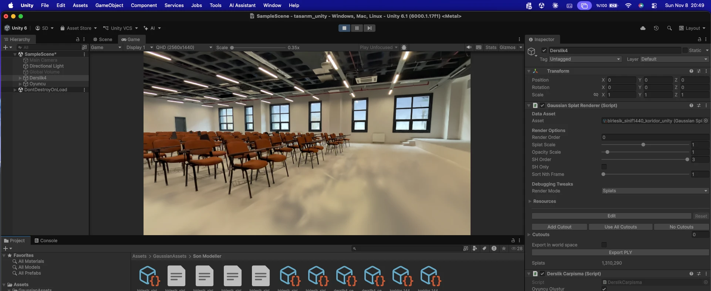
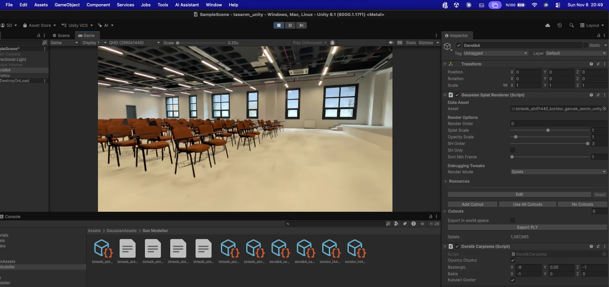

# Gerçek karelerden düz zemin: yöntem, artılar, eksiler, kullanım alanı (08.11.2026)

Betik: `scripts/hafta06/zemin_gercek.py`. Tanı ve önceki deney: `sonuclar_zemin.md`.

| Eski zemin | Gerçek karelerden düz zemin |
| :---: | :---: |
|  |  |

Üstten renk haritası: `zemin_harita_son.jpg`.

## 1. Sorun

Sınıfın beyaz, parlak ve dokusuz zemininde Unity'de renk dalgaları ve bulut benzeri lekeler görünüyordu. Ölçümlere göre gerçek yansıma etkisi yalnız %5–6, buna karşılık zemindeki Gaussian ağırlığının %54–88'i gerçek zeminin 8 cm'den fazla altında. Yani leke, kameranın gördüğü bir şey değil, eğitimin zemini yanlış yere kurmasının sonucu. Gaussian'ları zemine indirmek sorunu çözmedi, çünkü zeminin görünümünü zaten bu yanlış yerleşmiş Gaussian'lar taşıyordu.

## 2. Nasıl yapıldı

Eğitim yapılmadı. Hazır SfM pozları, 1080p kareler ve birleşik Unity PLY dosyası kullanıldı.

1. **Zemin düzlemi:** Ana zemin, y = −1,52 cm yüksekliğinde tek düzlem kabul edildi. Bölge platform ön kenarından karşı duvara, iki yan duvar arasına uzanıyor (19,0 × 14,9 m).
2. **Izgara:** Bölge 5 cm'lik hücrelere bölündü (381 × 298 = 113.538 hücre).
3. **Karelere izdüşüm:** Her hücre, onu 10 m'den yakın ve yeterince dik açıyla (sin θ > 0,16) gören karelere izdüşürüldü, mercek bozulması hesaba katıldı.
4. **Piksel eleme:** Sandalye gibi koyu veya renkli pikseller (en parlak kanal 90–252 aralığı dışı, doygunluk ≥ 0,36) atıldı. Kalan örnek sayısı 10.411.294.
5. **Pozlama düzeltmesi:** Log parlaklık = hücre + kare modeli 6 tur medyanla çözüldü, böylece kareler arası parlaklık farkı silindi.
6. **Hücre rengi:** Düzeltilmiş örneklerden hücre medyanına ±%15 yakın olanların medyanı alındı. Tek bakıştan gelen yansıma bu adımda eleniyor. En az 4 örnek şartı arandı.
7. **Sandalye altı:** Yakın çevresinden %10'dan koyu hücreler (sandalye ve gölge kalıntısı) genişletilip yakındaki temiz zeminin rengiyle dolduruldu (hücrelerin %38,2'si). Sonra hafif bulanıklaştırma (σ = 0,7 hücre) uygulandı.
8. **PLY'a yazma:** Bölgede y < +1,5 cm olan Gaussian'lar silindi. Her hücreye bir yassı Gaussian kondu: yatay σ 3,3 cm, düşey 2 mm, opaklık 0,995, görüşe bağlı renk terimleri (`f_rest`) sıfır.

| Dosya (Drive `birlesik/`) | Silinen | Eklenen | Toplam Gaussian | Boyut |
| :--- | ---: | ---: | ---: | ---: |
| `birlesik_sinif1080_koridor_gercek_zemin_unity.ply` | 29.473 | 113.538 | 1.059.235 | 262,7 MB |
| `birlesik_sinif1440_koridor_gercek_zemin_unity.ply` | 35.843 | 113.538 | 1.387.985 | 344,2 MB |

Süre: kareler sanal makinede hazırken yaklaşık 3 dakika, GPU kullanılmıyor. Boyut artışı 1080 modelde 20,7 MB, 1440 modelde 19,2 MB.

## 3. Artılar

| Artı | Dayanak |
| :--- | :--- |
| Dalga ve lekeler kalkıyor | Unity karşılaştırması. Katman her açıdan aynı renkte olduğu için eğitim karelerinden uzak bakışlarda da bozulmuyor |
| Görsel kaynak gerçek | Renk, eğitimin tahmini değil, gerçek karelerin medyanı |
| Geometri doğru yerde | Zemin tek düzlem. Seyrek noktalara göre gerçek zemin düzlemsellik hatası RMS 0,75 cm |
| Çarpışma ile uyumlu | Zemin collider'ı y ≈ −1,5 cm'e tam oturtulabilir, zemin altı Gaussian'lar yok |
| Yürüyüş ve VR için rahat | Yere yakın ve yere bakan görüşte yüzen bulut kalmıyor |
| Ucuz ve geri alınabilir | Yeniden eğitim yok, ~3 dk. Özgün PLY'lar değişmedi |
| Pozlama farkına dayanıklı | Kare başına parlaklık düzeltmesi var (kareler arası fark std %6,7 idi) |

## 4. Eksiler ve sınırlar

| Eksi | Etkisi |
| :--- | :--- |
| Yansıma ve parlaklık gitti | Zemin gerçekte parlak, modelde mat. Bakışla değişen ışık yok |
| Çözünürlük ~5–10 cm | Karo derzi, ince çizik ve küçük işaretler görünmez |
| Sandalye altı tahmin | Hücrelerin %38,2'si komşu zeminin rengi. Gerçek gözlem değil |
| Üstten bakışta adacıklar | Dolgu ile ölçülen zemin arasında tırtıklı ton farkı ve sıra aralarında açık bantlar var. Normal göz hizasında göze batmıyor, üstten bakışta görünür |
| Temas gölgeleri silindi | Sandalye ayaklarının yere bastığı yerdeki koyuluk kalktı; sandalyeler biraz yüzüyor gibi görünebilir |
| Yere çok yakın detay | y < +1,5 cm silindiği için ayak uçları ve zemine yakın ince parçalar etkilenir. Eski görüntüde belli olan sandalye altı tel sepetler yeni görüntüde belirgin değil, yakından kontrol edilmeli |
| Tek düzlem varsayımı | Eşik, rampa, küçük kot farkı katmanda yok. Zemin görüntüsü erişilebilirlik ölçümü için kanıt sayılmamalı |
| Kapsam yalnız ana zemin | Platform ve koridor zemini eski halinde. Sınırlarda ton veya doku farkı oluşabilir |
| Sayısal doğrulama yok | PSNR/SSIM yeniden hesaplanmadı. Değerlendirme görsel |
| Işık sabit | Medyan renk çekim anının ışığını taşır, sahne ışığı değişirse zemin tepki vermez |

## 5. Hangi zeminlerde kullanılır

| Durum | Uygunluk | Not |
| :--- | :--- | :--- |
| Düz, tek renk, parlak zemin (sınıf, koridor, lobi, sergi salonu, hastane) | Çok uygun | Bu yöntemin hedefi |
| Düz, dokusuz mat zemin (boyalı beton, epoksi) | Uygun | Yansıma olmasa da dokusuz zeminde derinlik belirsiz kalabilir |
| Karolu, derzli, desenli zemin | Koşullu | Hücreyi 1–2 cm'e indirmek, poz doğruluğunu ve kare netliğini kontrol etmek gerekir. Küçük poz hatası deseni bulanıklaştırır |
| Halı | Koşullu | Eğitimin iyi sonuç verdiği yerde gereksiz, düz görünüm dokuyu kaybettirebilir |
| Birden çok düz seviye (platform, basamak düzlükleri) | Koşullu | Her seviye ayrı düzlem ve ayrı maske ister, kenarlarda dikkat gerekir |
| Sabit oturma düzeni, zeminin çoğu görünmüyor (amfi) | Zayıf | Dolgu oranı büyür, sonuç çoğunlukla tahmin olur |
| Rampa, eğimli yol | Koşullu / Zayıf | Eğimli düzlem modeli gerekir; erişilebilirlik için eğim ölçülerek girilmeli |
| Merdiven, kavisli, düzensiz yüzey, dış mekân zemini | Uygun değil | Tek düzlem varsayımı bozulur |
| Yansımanın görülmesi istenen ayna gibi zemin | Uygun değil | Yöntem yansımayı bilerek siler |
| Ölçüm, eşik veya kot denetimi | Uygun değil | Katman düzlem varsayımıyla üretilir; ölçüm mezura veya SfM noktalarından alınmalı |

Pratik kural: zemin gerçekten tek düzlemse, yeterince çok açıdan görülmüşse ve görevi görsel olarak düzgün bir yürüme yüzeyi sağlamaksa uygundur.

## 6. Literatürle ilişkisi

- Düşük dokulu iç mekân yüzeylerinde fotometrik kaybın geometriyi belirsiz bıraktığı [PlanarGS](https://arxiv.org/abs/2510.23930) tarafından da belirtiliyor. Bu çalışma eğitime düzlem ve derinlik/normal kısıtları ekliyor; bizim tanımızla örtüşüyor.
- [Gaussian Splatting in Mirrors](https://arxiv.org/abs/2410.01614), 3DGS'in yansımaları sanal bir uzay gibi yorumladığını söylüyor. Zemin altına yerleşen Gaussian'lar bu davranışa benziyor. Bizim zeminimiz ayna değil, bu yüzden bu bağ bir benzerlik olarak okunmalı.
- [RefGaussian](https://arxiv.org/abs/2406.05852) ve [SpecTRe-GS](https://openaccess.thecvf.com/content/CVPR2025/papers/Tang_SpecTRe-GS_Modeling_Highly_Specular_Surfaces_with_Reflected_Nearby_Objects_by_CVPR_2025_paper.pdf) yansımayı silmek yerine modelliyor; yansımayı korumak isteniyorsa doğru yön bunlar, ama eğitim ve özel render gerektirir ve mevcut Unity eklentisine doğrudan aktarılamayabilir.
- Çok görüntülü doku üretiminde poz ve geometri hatalarının kaymaya, uzak görüntülerin bulanıklığa yol açtığı [Waechter vd.](https://link.springer.com/content/pdf/10.1007/978-3-319-10602-1_54.pdf) tarafından belirtiliyor. Tırtıklı geçişlerin giderilmesi için [çok bantlı karıştırma](https://typeset.io/pdf/blending-images-for-texturing-3d-models-3qrsvjdrm5.pdf) kullanılabilir.
- [RePaintGS](https://arxiv.org/abs/2507.08434) ve [Inpaint360GS](https://arxiv.org/abs/2511.06457) gibi çalışmalar kapalı bölgeleri üretken doldurma ile tamamlıyor. Bizim dolgu çok daha basit: yalnız yakın zeminin rengi.

Bu yöntemin aynısını yapan bir yayın aramada bulunmadı. Yöntem, klasik çok görüntülü doku üretiminin düz zemine ve Gaussian katmanına uygulanmış basit bir halidir.
